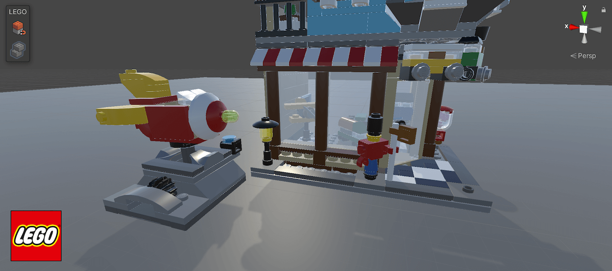

# LEGO Model Importer

The purpose of LEGO Model Importer is to help you import LEGO models into Unity or build new models using our Connectivity System.

## Features

- **Import models from Bricklink Studio**
- **Import LDR files**
- **Various optimization options for the imported model**
- **In Unity Editor Connectivity system to alter or create a new model**

## Install with Unity Package Manager

Requires Unity 2021.2.7f1 or later and Git installed on your computer.

1. Open **Window > Package Manager**.
2. Click **+ > Add package from git URL**.
3. Enter `https://github.com/ESCG-Lewes/com.unity.lego.modelimporter.git`.
4. Click **Add**.

The package declares dependencies on LEGO Materials 3.0.2, Universal RP 12.1.2,
and Unity UI 1.0.0. Unity must be able to resolve these from its configured
registries. If LEGO Materials cannot be resolved, install that package separately
from its available source before adding this importer. Git dependencies belong
in the consuming project's `Packages/manifest.json`, not this package's dependencies.

This replaces the existing `com.unity.lego.modelimporter` package; do not keep a
second copy under Assets. Git LFS is not needed: the larger part archives are
stored as split files and the importer reconstructs them automatically.

To test a local checkout before publishing, choose **Add package from disk** and
select this repository's `package.json`. Repository changes must be committed and
pushed before a Git URL installation can fetch them.

## Instructions

For documentation see [Documentation](Documentation~/LEGO%20Model%20Importer.md)

The current version requires **Unity 2021.2+**.

## Community and Feedback

For any feedback or bug reports please reach out to LEGO Games.

Email: [LEGOUnityPackages@lego.com](mailto:LEGOUnityPackages@lego.com)

## License & Terms of Agreement

LEGO Companion License (“License”) Software Copyright © 2020 LEGO System A/S

For licensing details see [LICENSE.md](LICENSE.md)

## BrickLink Studio 2 colour support

Verified with **BrickLink Studio 2.26.10_1**. With the updated LEGO Model Importer and LEGO Materials packages installed, all 226 LDraw colour codes in that Studio palette resolve to Unity materials when importing `.ldr` models. Satin, glitter and speckle finishes are approximations. Glitter and speckle use material settings without individual rendered particles.

## Studio parts supplement

Export a model from BrickLink Studio as **LDraw (.ldr)**, then open it in Unity
with **LEGO Tools > Import Model**. This release adds FBX archives for animals,
props and common building shapes such as plates, slopes, and doors and windows.
The generator excludes Technic categories and skips flexible parts. Unity
unpacks requested FBXs into `Assets/LEGO Data/Geometry/Studio` as needed.

Supplemental parts use the model's main part colour and one level of detail.
Enable **Colliders** and **Connectivity** when importing or reimporting a model
to use the original Unity LEGO snapping system. The supplement converts
supported Studio stud grids, clips, bars, and collision boxes. Some parts
have missing data or use other connection types. See
`Data/StudioConnections.tsv` for coverage by part. Printed colours and
textures are outside the supplement's scope.

To rebuild from the Studio library currently installed on your Mac, run
`python3 Tools~/build_studio_parts.py`, then
`python3 Tools~/build_studio_connections.py` from the package directory. On
another installation, use `--studio <Studio installation folder>`. Each ZIP is
independent and stays below 100,000,000 bytes. See `Data/StudioParts.tsv` for
included part IDs and `Data/StudioParts-skipped.tsv` for conversion failures.

The building-shapes bundle also includes bars, dishes, cylinders and exact
Studio mould variants for small bricks, slopes, plates and tiles. Some of
those variants previously shared a generic Unity mesh. Their exact geometry
uses the supplemental import path with connection and collision data where
available.

Brick Building mode supports selecting and placing bricks without snap data,
including visual-only parts. They can be decoupled from a group. Where Studio
provides collision boxes but no usable connections, the generator can infer
ordinary solid and hollow studs from explicit LDraw stud primitives.
`Data/StudioConnections.tsv` identifies the inferred studs. Specialized joints
still require authored connection data.
